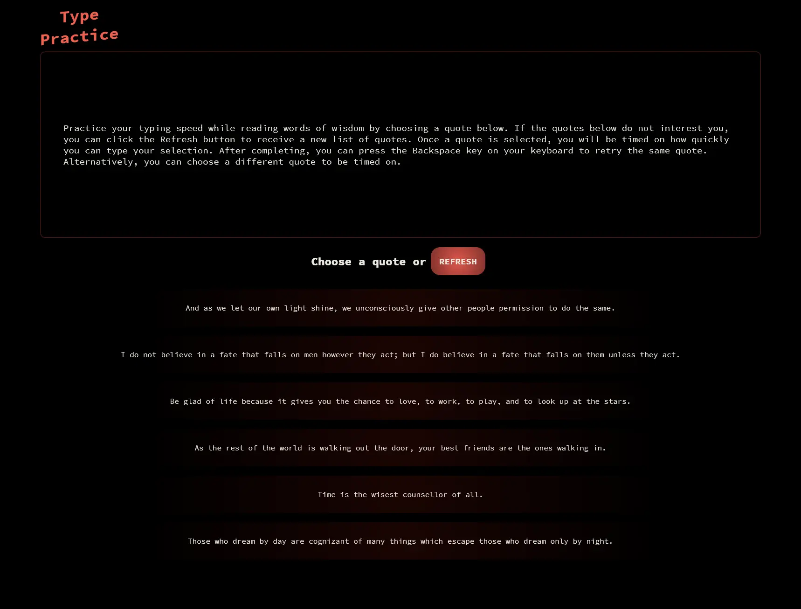

# Type Practice

Practice your typing speed while reading words of wisdom.

[View the application](https://type-practice.theodoremoreland.dev/)

The application attempts to retrieve each quote dynamically via HTTP request(s). The application will use static data upon failure.

## Table of contents

- [Technologies used](#technologies-used)
- [Data sources](#data-sources)
- [Screenshots](#screenshots)
  - [Desktop](#desktop)
  - [Mobile](#mobile)

## Technologies Used

- React.js
- TypeScript
- HTML5
- CSS3
- Vite
- TanStack / React Query
- Zod
- ESLint
- Prettier
- VS Code

## Data sources

- Source of quotes (deprecated): https://api.quotable.io/random
- Source of fallback quotes: https://type.fit/api/quotes

## Screenshots

### Desktop

### Mobile

