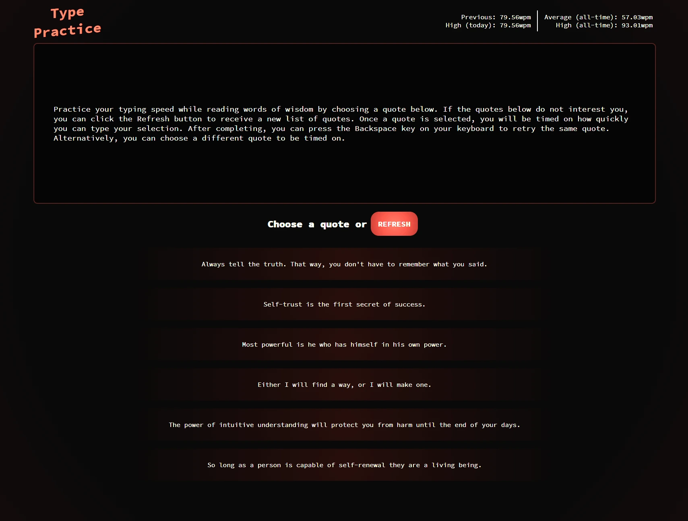

# Type Practice

Practice your typing speed while reading words of wisdom.

[View the application](https://type-practice.theodoremoreland.dev/)

## Table of contents

- [Technologies used](#technologies-used)
- [Screenshots](#screenshots)
  - [Desktop](#desktop)
  - [Mobile](#mobile)

## Technologies Used

- React.js
- TypeScript
- HTML5
- CSS3
- Vite
- ESLint
- Prettier
- VS Code

## Screenshots

### Desktop

### Mobile

